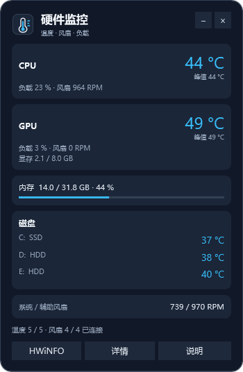

# HWiNFO Desktop Panel

基于 HWiNFO 传感器输出的 Windows 桌面硬件监控面板。界面使用 PowerShell 与 WPF，适合常驻查看温度、风扇和负载。

**本仓库提供面板源码。HWiNFO 软件需自行从[官方网站](https://www.hwinfo.com/download/)获取。**



## 功能

- CPU/GPU 温度、负载与对应风扇转速按设备分组显示。
- GPU 显存占用、系统物理内存占用及进度条。
- 三块磁盘温度合并显示，悬停查看设备型号与实际传感器来源。
- 系统/辅助风扇合并显示，悬停查看原始接口名称。
- 本次运行的温度峰值，可在详情中重置。
- 可选诊断项：功耗、平均有效频率、GPU 热点、CPU 热降频及 GPU 温度限制；没有数据的可选项隐藏。
- 支持置顶、透明度、拖动窗口，以及温度变色阈值。采用紧凑布局，不包含趋势曲线。
- 标题和任务栏使用独立的温度监控图标。
- 标题栏 **−** 将面板隐藏到系统托盘，后台继续监控；双击托盘图标或右键选择“显示面板”可恢复。托盘右键“退出面板”或标题栏 **×** 会退出面板。

## 运行环境

- Windows 10/11，64 位 Windows PowerShell 5.1 与系统自带 WPF/.NET Framework。
- 单独安装或下载 HWiNFO，启用传感器监控及 Gadget 输出。
- NVIDIA 驱动的 NVML 为 GPU 利用率、显存占用及可选功耗提供额外数据；没有 NVML 时其余面板仍可使用。

## 快速开始

1. 下载本仓库文件到同一目录。
2. 自行下载 HWiNFO，将 `HWiNFO64.exe` 放在该目录，或在 `panel.json` 的 `hwinfoPath` 中填写其完整路径。
3. 打开 HWiNFO 传感器窗口，点齿轮进入 **HWiNFO 小工具 / HWiNFO Gadget**。
4. 勾选 **启用向小工具报告 / Enable reporting to Gadget**；逐个选中所需传感器，再勾选 **小工具中的报告值 / Report value in Gadget**。
5. 按下一节调整 `panel.json`，匹配自己的硬件和传感器名称。
6. 双击 `StartPanel.vbs`，通过无控制台的启动入口打开面板。

启动入口使用 Windows Script Host；如果系统禁用了 VBScript，可手动用本页“验证”章节中的 PowerShell 命令去掉 `-ValidateOnly` 启动面板。

启动器会在 HWiNFO 未运行时启用“记住偏好设置”，默认同时开启传感器采集、最小化传感器窗口，并启用“最小化传感器而非关闭”。主界面、仅传感器模式、欢迎窗口及主窗口最小化选项会保留用户的选择。如果 Windows 请求管理员许可，请自行确认。HWiNFO 已运行时，启动器会使用现有进程，不强制重启或改写运行中的设置。

**默认不导入注册表备份。** 传感器选择由 HWiNFO 自己保存；面板按设备名、项目名和单位读取数据，而不是依赖容易变化的 Gadget 索引。

## 传感器窗口与后台采集

HWiNFO 主界面运行不代表传感器采集已经启动。Gadget 温度与 RPM 需要 HWiNFO 持续采集；传感器窗口可以保持最小化，不需要一直显示在桌面上。

- 默认 `startup.startSensors=true`：在下一次由面板启动 HWiNFO 时，写入 `OpenSensors=1`、`MinimalizeSensors=1` 和 `MinimalizeSensorsClose=1`。不强制启用仅传感器模式，主界面仍然可用。
- 如正在运行的 HWiNFO 尚未采集，请在主窗口点“传感器”；或从托盘正常退出后，再双击 `StartPanel.vbs`，应用新的启动设置。
- 要只收起传感器并保留主窗口，点传感器右上角的 **−（最小化）**。任务栏可能保留传感器图标，采集会继续。
- 启用“最小化而非关闭”后，**×** 会保留后台采集，但缩到托盘可能连带收起主窗口。需要完全退出时，使用托盘的 Exit；此时温度和 RPM 会断连。
- 若希望完全自行管理传感器启动和关闭行为，可设置 `startup.startSensors=false`。启动器将保留上述三个传感器窗口选项。
- 面板会区分 HWiNFO 未运行、没有新鲜的传感器输出，以及输出已收到但温度项目没有匹配。没有输出时，应检查采集是否启动及 Gadget 是否启用，不会显示旧温度冒充实时数据。

## 配置与传感器选择

随附 `panel.json` 是一个硬件示例：Intel Core i5-12490F、NVIDIA RTX 4060，以及 C:/D:/E: 三块磁盘。它需要适配你的电脑，并非通用即用配置。

| 配置字段 | 用途 |
|---|---|
| `hwinfoPath` | HWiNFO 路径；相对路径以面板目录为基准 |
| `width`、`topmost`、`opacity` | 窗口宽度、置顶与透明度 |
| `refreshSeconds` | 面板读取间隔，默认 2 秒 |
| `staleSeconds` | Gadget 输出超过该时长未更新时，视为过期 |
| `gpuPattern` | NVML 返回的显卡名称需匹配此正则 |
| `sensorPattern` | HWiNFO 设备/分组名称的正则表达式 |
| `labelPattern` | 分组下具体传感器名称的正则表达式 |
| `unit` | 区分 RPM、百分比、温度、功耗、频率和是/否状态 |
| `warm`、`hot` | 温度显示变色阈值，按设备自行调整 |
| `startup.enabled` | 是否自动准备并启动 HWiNFO |
| `startup.startSensors` | 默认 true，启动时开启并最小化传感器，× 保留后台采集 |

推荐选择：

- Intel CPU：DTS 分组下的 **CPU Package / CPU 封装**。
- GPU：**GPU Temperature / GPU 温度**；GPU 热点是另一个测量位置。
- 磁盘：SMART 分组下的 **磁盘温度 / Drive Temperature**。
- 风扇：选择单位为 **RPM** 的项目。相同名称可能另有百分比项，二者不能互换。

示例主板使用 `CPUFANIN0`、`SYSFANIN`、`AUXFANIN3`，显卡使用 `GPU 风扇1`。其他主板的名称可能不同，需要相应修改匹配规则。接口名称不能证明实际接线；辅助风扇接口也不能认定为电源内部风扇。

CPU/GPU 的 `name` 保持为 `CPU`/`GPU`，以进入对应设备卡片。其余温度项进入磁盘列表；`subtitle` 以 `C:` 等盘符开头时会显示盘符。

## 数据含义与限制

- 温度及 RPM 来自 HWiNFO Gadget 注册表接口；CPU 负载与内存来自 Windows API；GPU 利用率和显存来自 NVIDIA NVML。
- NVML 当前查询第一块 NVIDIA GPU，并按 `gpuPattern` 校验其名称。多显卡或 AMD 显卡环境需要调整/扩展相应后端。
- 温度按整数显示；悬停可以查看原始读数及数据来源。
- 峰值仅覆盖本面板启动或重置后的采样，关闭后不保留。它不等于 HWiNFO 全程的 Maximum 列，采样之间的瞬时尖峰也可能未被捕获。
- 合法的 `0 RPM` 会原样显示；缺失数据不会显示为零。如果只有 GPU 控制百分比，界面会明确标为“控制 x %”。
- 基础温度或风扇断连时保留位置并显示缺失状态；可选诊断项在没有数据时隐藏。
- 温度颜色是显示偏好，不是设备健康结论。判断散热需结合负载、厂商限制和热降频状态。
- 程序不会调整电压、频率或风扇曲线，不添加开机自启，也不持续保存遥测日志。

## 配置保存与恢复

如果 HWiNFO 不保存设置，请检查其主设置中的 **Remember Preferences / 记住偏好设置**，并正常退出程序以保存配置。

本仓库不附带某台电脑的 `RestoreHWiNFO.reg`。如需备份，使用 HWiNFO 主设置的 **Backup User Settings**。只有确认设置丢失时，才在完全退出 HWiNFO 后手动恢复自己的备份。

`startup.restoreOutputProfile` 默认是 `false`。若主动设为 `true`，启动脚本会在启动 HWiNFO 前导入同目录的 `RestoreHWiNFO.reg`；该文件必须由你为自己的电脑准备。

## 文件

| 文件 | 说明 |
|---|---|
| `StartPanel.vbs` | Windows 无控制台的双击启动入口 |
| `Panel.ps1` | 紧凑面板界面、数据绑定与验证入口 |
| `NativeTelemetry.cs` | Windows 与 NVIDIA 的只读遥测 |
| `assets/panel.ico`、`assets/panel.svg` | 多尺寸 Windows 图标与可编辑的矢量源图 |
| `tools/BuildIcon.ps1` | 从矢量源图生成 Windows 图标 |
| `PrepareHWiNFO.ps1` | HWiNFO 启动准备，默认不导入备份 |
| `panel.json` | 可编辑的硬件示例与显示设置 |

启动器的执行策略参数只作用于此次 PowerShell 进程，不修改系统执行策略。

## 验证

以下检查不启动 HWiNFO，也不修改真实的 HWiNFO 设置：

```powershell
powershell.exe -NoProfile -STA -ExecutionPolicy Bypass -File .\Panel.ps1 -ValidateOnly
powershell.exe -NoProfile -ExecutionPolicy Bypass -File .\PrepareHWiNFO.ps1 -ValidateOnly
```

托盘行为可用 `powershell.exe -NoProfile -STA -ExecutionPolicy Bypass -File .\Panel.ps1 -ValidateTray` 验证。该检查会短暂打开测试窗口，验证隐藏期间继续采集、恢复和退出清理，不启动或重启 HWiNFO。

验证覆盖单位区分、合法零转速、缺失数据、传感器匹配、热降频聚合，以及启动选项对其他 INI 设置的保留。

## 参考

- [HWiNFO 与 Gadget 注册表接口](https://docs.rainmeter.net/tips/hwinfo/)
- [HWiNFO 小工具设置不保存的官方答复](https://www.hwinfo.com/forum/threads/report-to-gadget-setting-does-not-persist.9445/)
- [HWiNFO 有效频率说明](https://www.hwinfo.com/forum/threads/effective-clock-vs-instant-discrete-clock.5958/)
- [NVIDIA NVML](https://docs.nvidia.com/deploy/nvml-api/index.html)
- [MSI Afterburner 监控与显示指南](https://www.msi.com/blog/msi-afterburner-on-screen-display/)

- [HWiNFO 作者对主窗口与传感器窗口最小化行为的说明](https://www.hwinfo.com/forum/threads/hiding-the-main-gui-without-hiding-sensors.11016/)
